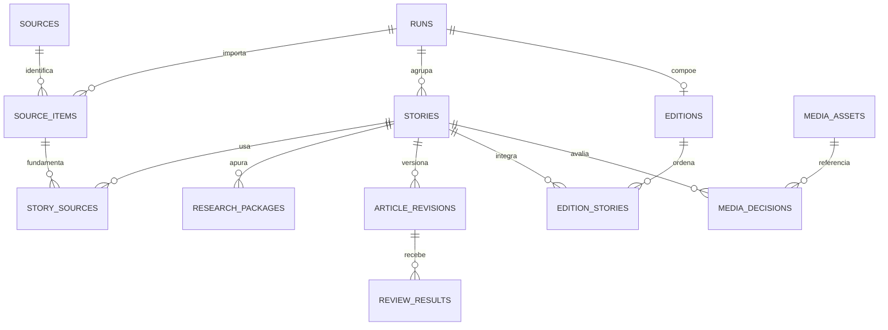

# ENG-CODEX-006 — D0: mapa do SQLite para memória editorial

- **Setor responsável:** Engenharia e Codex
- **Identificador do artefato:** ENG-CODEX-006-D0
- **Versão:** v0.1
- **Status:** em_revisao
- **Data de atualização:** 2026-10-24 17:58 America/Sao_Paulo
- **Dependências:** Issue [#23](https://github.com/Saaimingo/Revista_Gamer/issues/23), comentário [6378715359](https://github.com/Saaimingo/Revista_Gamer/issues/23#issuecomment-6378715359); Issue [#20](https://github.com/Saaimingo/Revista_Gamer/issues/20), decisão [6376215182](https://github.com/Saaimingo/Revista_Gamer/issues/20#issuecomment-6376215182); PR [#21](https://github.com/Saaimingo/Revista_Gamer/pull/21), proposta em rascunho
- **Aprovador:** Direção; revisão e aceite pendentes.

**Resultado da unidade:** D0 concluída como levantamento documental; sem mudança de schema ou implementação.

Branch: `codex/eng-codex-006-e2e-experiment`

PR: [#26](https://github.com/Saaimingo/Revista_Gamer/pull/26), draft.

## Autoridade e limite desta unidade

A Issue [#20](https://github.com/Saaimingo/Revista_Gamer/issues/20) continua aberta. A decisão da direção no comentário [6376215182](https://github.com/Saaimingo/Revista_Gamer/issues/20#issuecomment-6376215182) admite como princípio a recuperação interna de matérias aprovadas internamente, inclusive inéditas, desde que status, proveniência e visibilidade pública não se confundam. A mesma decisão não autoriza implementação, migração, merge, integração social, skills ativas, agentes novos ou custos; nomes e esquema exatos permanecem proposta a validar.

A PR [#21](https://github.com/Saaimingo/Revista_Gamer/pull/21) segue aberta em rascunho e se declara proposta para debate, não aprovada nem executável. A prioridade registrada é memória editorial antes da primeira matéria real; skills evolutivas e conexões sociais ficam para fases posteriores. Este documento apenas registra o estado atual e os pontos de encaixe.

## Evidência do schema observado

`motor_editorial.db.SCHEMA_VERSION` vale 5. Foi criado um banco **temporário e vazio**, inicializado pelo `Store` atual, e consultados `PRAGMA user_version`, `sqlite_master`, `PRAGMA table_info` e `PRAGMA foreign_key_list`. O resultado foi `user_version=5` e 17 tabelas: `runs`, `sources`, `source_items`, `stories`, `story_sources`, `research_packages`, `article_revisions`, `review_results`, `media_assets`, `media_decisions`, `editions`, `edition_stories`, `execution_attempts`, `audit_events`, `agent_tasks`, `agent_task_events` e `agent_schedules`. Não há tabela `personas`, `persona_versions`, `games`, `franchises`, `publication_receipts` ou `editorial_memory` no schema v5 observado. Índices foram excluídos da contagem de tabelas.

Comando executado para observar o schema sem abrir ou alterar banco persistente:

```powershell
& '.\.venv\Scripts\python.exe' -c "import json,sqlite3,tempfile; from pathlib import Path; from motor_editorial.db import SCHEMA_VERSION,Store; tmp=tempfile.TemporaryDirectory(); root=Path(tmp.name); db=root/'motor.sqlite3'; Store(db,root/'artifacts'); c=sqlite3.connect(db); names=[r[0] for r in c.execute('SELECT name,type FROM sqlite_master ORDER BY name') if r[1]=='table' and not r[0].startswith('sqlite_')]; relevant={'sources','source_items','runs','stories','story_sources','research_packages','article_revisions','review_results','editions','edition_stories','audit_events','media_assets','media_decisions'}; detail={n:{'columns':[r[1] for r in c.execute('PRAGMA table_info('+n+')')],'foreign_keys':[{'table':r[2],'from':r[3],'to':r[4]} for r in c.execute('PRAGMA foreign_key_list('+n+')')]} for n in names if n in relevant}; print(json.dumps({'schema_version_constant':SCHEMA_VERSION,'pragma_user_version':c.execute('PRAGMA user_version').fetchone()[0],'tables':names,'detail':detail},ensure_ascii=False)); c.close(); tmp.cleanup()"
```

O DDL correspondente está em [`db.py`](../../motor_editorial/db.py#L83); a versão declarada está em [`SCHEMA_VERSION`](../../motor_editorial/db.py#L18). Este resultado demonstra o schema criado pelo código atual, não uma inspeção de banco de produção.

Também existe o banco local ignorado `motor_editorial/runtime/motor.sqlite3`. Ele foi aberto exclusivamente com URI `mode=ro`, sem consultar linhas de conteúdo. O `PRAGMA user_version` observado é 4 e há as mesmas 17 tabelas do schema v5 atual; a diferença de colunas é `agent_tasks.lease_owner` e `agent_tasks.lease_generation`, ausentes no runtime v4 e adicionadas pela migração atual. O schema v5 atualiza `user_version` ao inicializar e executa `ALTER TABLE`; por isso este arquivo local não foi aberto via `Store` nem migrado durante D0.

Comando de inspeção do runtime local (somente leitura):

```powershell
& '.\.venv\Scripts\python.exe' -c "import json,sqlite3; from pathlib import Path; p=Path('motor_editorial/runtime/motor.sqlite3').resolve(); c=sqlite3.connect(p.as_uri()+'?mode=ro',uri=True); names=[r[0] for r in c.execute('SELECT name,type FROM sqlite_master ORDER BY name') if r[1]=='table' and not r[0].startswith('sqlite_')]; relevant={'sources','source_items','runs','stories','story_sources','research_packages','article_revisions','review_results','editions','edition_stories','audit_events','media_assets','media_decisions'}; detail={n:{'columns':[r[1] for r in c.execute('PRAGMA table_info('+n+')')],'foreign_keys':[{'table':r[2],'from':r[3],'to':r[4]} for r in c.execute('PRAGMA foreign_key_list('+n+')')]} for n in names if n in relevant}; print(json.dumps({'path':str(p),'pragma_user_version':c.execute('PRAGMA user_version').fetchone()[0],'tables':names,'detail':detail},ensure_ascii=False)); c.close()"
```

## Entidades e relações atuais



`audit_events` relaciona `entity_type` e `entity_id` como valores genéricos, sem chave estrangeira. A sequência, instante, ator, origem, estado anterior/posterior e `artifact_ref` dão trilha técnica ampla, mas não impõem integridade para cada tipo de entidade.

| Entidade | Campos e ligação existentes | Encaixe e lacuna para a memória futura |
| --- | --- | --- |
| `runs` | Execução, cenário e estado; agrupa pautas e fontes por `run_id`. | Contexto de processamento, não identidade estável de jogo nem memória longitudinal. |
| `sources`, `source_items`, `story_sources` | Catálogo de origem; item importado com identificador, data de publicação da **fonte**, resumo, hash, tópico e deduplicação; associação muitos-para-muitos entre item e pauta. | A proveniência editorial já tem ligação relacional até a pauta. `published_at` aqui é da fonte externa, não da Revista Gamer. |
| `stories` | `run_id`, `topic_key`, pergunta, estado, número da revisão corrente e estado de processamento; unicidade `(run_id, topic_key)`. | É a entidade natural da matéria compartilhada. `topic_key` e pergunta são texto; não há entidade normalizada de jogo, franquia ou assunto. |
| `research_packages` | Versões por `story_id`; `content_json` pode carregar fontes, afirmações, incertezas e marca sintética. | A ligação com a matéria é FK; IDs de fonte dentro do JSON não são FKs individuais. Não há autor/persona estruturado nesse pacote. |
| `article_revisions` | Versão única por matéria, conteúdo, `author_role`, estado (`draft`, `rejected`, `corrected`, `approved`) e data. | Preserva versões/correções. `author_role` não identifica pessoa/persona estável nem versão/hash do DNA; não há hash de conteúdo dedicado nesta tabela. |
| `review_results` | FK para matéria e revisão, número da rodada, `approved`, achados em JSON e data. | Permite vincular revisão ao texto exato pelo `revision_id`; não registra perfil/versão/hash do revisor em coluna própria. |
| `editions`, `edition_stories` | Edição ligada ao run; status interno, caminho de preview, `composition_status`, fingerprint, aprovação por/instante; associação ordenada com pautas, inclusão/exclusão e justificativa. | A composição e aprovação interna são rastreáveis. Não há prova/recibo externo que demonstre publicação da matéria ou de uma revisão específica. |
| `media_assets`, `media_decisions` | Ativo e estado de permissão/modo; decisão por pauta, obrigatoriedade, razão e data. | Direitos de mídia ficam ligados à pauta, mas não são a memória narrativa de personagem. |
| `execution_attempts`, `agent_tasks`, `agent_task_events`, `agent_schedules` | Tentativas de etapas locais e fila/dispatcher/eventos/agendamentos do Motor. | São dados operacionais. `agent_tasks.profile_id/version/hash` identificam o perfil executor do job, não substituem a autoria editorial persona+DNA. A cadeia C0–C5 continua usando o ledger único `agent_tasks/agent_task_events`. |

O `Store.story_detail()` reúne fontes, revisões, revisões editoriais, mídia, pesquisa e eventos para uma pauta. A máquina de estados valida revisão/edição antes de aprovar internamente. A construção de `StoryPackage.v0` em `factory.py` carrega identidades sintéticas de editor, persona redatora e revisor com perfil, versão e hash no envelope; isso não cria uma tabela relacional de persona no SQLite v5.

## Lacunas e pontos de integração, sem decisão de esquema

1. **Autoria:** manter a matéria como registro único e atribuir persona + versão do DNA à revisão/posição editorial correspondente; a forma (colunas, tabela de identidade ou vínculo de autoria) ainda não foi escolhida. Não copiar fisicamente a mesma matéria uma vez por cronista.
2. **Jogo/franquia/assunto:** hoje a pauta e os itens de fonte guardam `topic_key` em texto. Uma relação estável e navegável por obra/franquia precisará de modelo próprio; usar o texto atual como ID canônico seria uma decisão não aprovada.
3. **Proveniência de pesquisa:** fontes ligam-se à matéria por `story_sources`, e os pacotes de apuração são versionados. Se consultas futuras exigirem prova por afirmação/fonte e datas, os IDs hoje embutidos em JSON podem precisar de relações explícitas; isso é opção para a especificação posterior.
4. **Correção e continuidade:** `article_revisions` já oferece histórico por versão, `review_results` identifica a versão revisada e `audit_events` registra transições. Uma memória deve preservar versão/hash e apontar correção, substituição ou retirada sem sobrescrever a revisão anterior.
5. **Visibilidade pública:** nenhum `published` ou comprovante de publicação existe nessas tabelas. `awaiting_human_approval`, `approved_internally`, HTML de preview, agendamento ou URL planejada não comprovam publicação externa. `approved_by/approved_at` referem-se à decisão interna.
6. **Acesso e retenção:** o schema mapeado não mostra uma camada de permissão de leitura por persona/usuário nem política de retenção da memória. D0 não presume que esses controles já existam.

## Decisões ainda reservadas

A direção/Fundador ainda precisa validar a taxonomia e os nomes exatos dos estados, a relação de persona com DNA/versionamento, o modelo de obra/franquia, a evidência necessária para marcar publicação externa, as regras de leitura de conteúdo aprovado porém inédito e a política de correções/retiradas e retenção. A base de direito para qualquer conteúdo e a prevenção de vazamento de matéria inédita continuam requisitos de decisão/validação humana. D0 não escolhe valores definitivos nem converte os exemplos do comentário da Issue #20 em schema aprovado.

## Evidência, arquivos e próximo passo

- Código observado: [`db.py`](../../motor_editorial/db.py#L18), [`workflow.py`](../../motor_editorial/workflow.py#L417), [`workflow.py`](../../motor_editorial/workflow.py#L707), [`workflow.py`](../../motor_editorial/workflow.py#L1412), [`workflow.py`](../../motor_editorial/workflow.py#L1447), [`workflow.py`](../../motor_editorial/workflow.py#L1488), [`workflow.py`](../../motor_editorial/workflow.py#L1561), [`workflow.py`](../../motor_editorial/workflow.py#L1763), [`factory.py`](../../motor_editorial/factory.py#L267), [`Store.story_detail`](../../motor_editorial/db.py#L648).
- Issue #20 aberta; decisão [6376215182](https://github.com/Saaimingo/Revista_Gamer/issues/20#issuecomment-6376215182) lida novamente. PR #21 é draft, aberta, sem merge e sem comentários/reviews; o próprio corpo a classifica como proposta não executável.
- Nenhum teste de produto foi executado para esta documentação. A inspeção temporária retornou schema v5/17 tabelas; o runtime local, em leitura somente, retornou v4/17 tabelas e as duas colunas pendentes acima. Não houve migração, escrita no runtime, leitura de linhas de conteúdo, rede, API paga, SIWC/Plus real, conta, permissão, publicação ou deploy.

D1 deve formalizar a proposta de estados independentes e a proveniência necessária para consultas de continuidade, incluindo matéria aprovada internamente ainda inédita e a simulação matéria→DLC sem publicação. Deve continuar documental e registrar os pontos que exigem decisão da direção.
