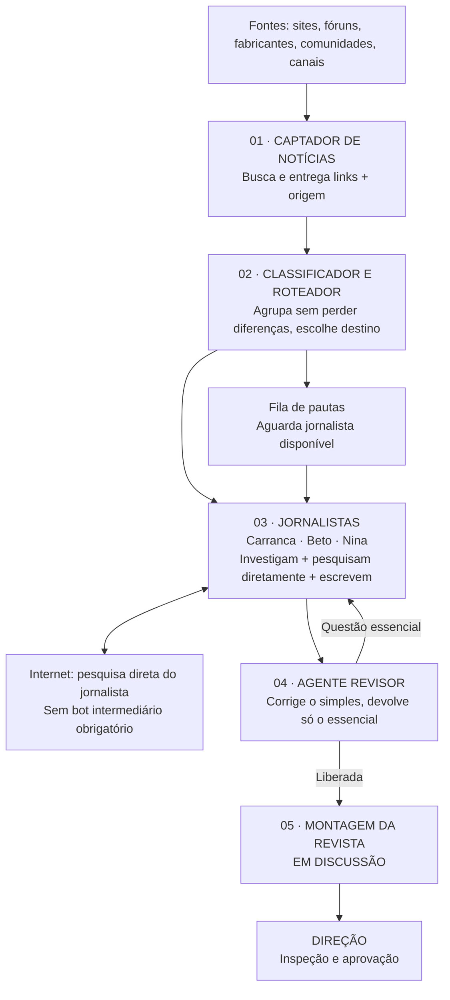

# REVISTA BACK — BACKUP DE CONTINUIDADE: FUNDADOR 2 → FUNDADOR 3#
**Data:** 27/10/2026, Brasil  
**Destino:** novo chat **Fundador 3#**, no Project Revista Gamer / Revista Back  
**Origem:** deliberações diretas da Direção com o Fundador 2 em 23–27/10/2026; conferência pontual do repositório GitHub e dos artefatos descritos abaixo.  
**Natureza:** handoff de concepção, contexto, decisões, limites e ponto de parada; **NÃO** ordem automática de engenharia ou autorização para executar ferramentas externas.

> ## LEIA ISTO PRIMEIRO, FUNDADOR 3#
>
> Este documento NÃO dá continuidade à antiga estratégia de consertar indefinidamente a ENG-CODEX-012. A Direção percebeu que a fábrica atual é complexa demais e trava por contratos e handoffs técnicos, embora os agentes façam trabalho real. Está redesenhando **a fábrica editorial de forma simples, bloco por bloco, antes de mandar o Codex implementá-la**. Preservar DNAs e peças úteis de código, mas não obrigar a nova arquitetura a herdar toda a cadeia antiga. O último assunto debatido foi **como aproveitar a mecânica mobile de leitura aprovada e os cinco modelos visuais de composição ainda em discussão para montar matérias reais**, mantendo liberdade de mesclar composições; **o Bloco funcional 05 não está fechado**. Continue exatamente daí. Não recomece perguntando ao diretor o que já foi aprovado.
>
> O diretor exige que **cada bloco seja homologado com operação real**, após testes auxiliares locais. Suíte verde de mocks/fixtures **não é prova de operação real**. Não acionar Codex, SIWC, pesquisas pagas, merge, publicação, redes sociais ou contratação com base somente neste handoff.

## 1. Onde buscar a origem e qual documento prevalece

- Repositório: https://github.com/Saaimingo/Revista_Gamer
- Backup histórico **Fundador 1 → Fundador 2** (necessário para visão integral): [BACKUP-CONTINUIDADE-FUNDADOR-2026-10-23.md](BACKUP-CONTINUIDADE-FUNDADOR-2026-10-23.md).
- Conceito inicial e história: [BÍBLIA](BIBLIA-DO-PROJETO.md), [DECISÕES](DECISOES.md), [STATUS-GERAL](STATUS-GERAL.md), [REGISTRO-BLOCOS](REGISTRO-BLOCOS.md), [MAPA-SETORES](MAPA-SETORES.md) e `AGENTS.md`. **Estes documentos contêm descrições antigas de 15–19/10**; consultar como histórico, não como fotografia operacional do dia 27.
- Engenharia, pré-retomada: [Issue #42, auditoria independente do Fundador 2](https://github.com/Saaimingo/Revista_Gamer/issues/42#issuecomment-6432841694), [ordem escrita à ENG-012](https://github.com/Saaimingo/Revista_Gamer/blob/codex/eng-codex-012-architecture-contracts/docs/engenharia/ENG-CODEX-012-ORDEM-DIRECAO-AUDITORIA-PRS-ESTRATEGIA-RADAR-2026-10-27.md) **na branch da PR #44**, [PR #44](https://github.com/Saaimingo/Revista_Gamer/pull/44), [PR #43](https://github.com/Saaimingo/Revista_Gamer/pull/43), e checkpoint da ENG-012 **na branch #44**, não necessariamente na main.
- Visual: [docs/visual/README.md](../visual/README.md) no GitHub; [PR #46](https://github.com/Saaimingo/Revista_Gamer/pull/46), documentação de avaliar bibliotecas de flipbook (não é a última aprovação visual); [PR #16](https://github.com/Saaimingo/Revista_Gamer/pull/16), mocks de referência.
- Hierarquia de decisão: a deliberação explícita **mais recente da Direção** > decisão específica aprovada e rastreada > evidência técnica real/versionada > hipóteses e documentos históricos. Não confundir parecer do assistente com decisão do diretor.

**Aviso central de nomenclatura:** o repositório ainda se chama `Revista_Gamer`, mas a marca adotada nas conversas atuais é **Revista Back**. Há também dois usos distintos de “bloco”:
1. **Blocos do Project/Chats (departamentos de concepção):** Fundador, 02 Personagens, 03 Identidade Visual, 04 Redação, 05 Acervo/Direitos, 06 Comercial.
2. **Blocos da NOVA ESTEIRA FUNCIONAL (etapas da fábrica):** 01 Captador, 02 Classificador/Roteador, 03 Jornalistas, 04 Revisor, 05 Montagem (ainda em discussão). Não confundir **Bloco 03 da concepção visual** com **Bloco 03 funcional de jornalistas**. Estes não exigem um novo chat/LLM por etapa.

## 2. Projeto, ambição e linha editorial: não perder

**Revista Back**: revista digital gratuita, inicialmente local durante desenvolvimento, aproximadamente **uma edição por mês**, especializada em games, história e cultura dos jogos, hardware em TODO seu universo (PC completo, componentes, consoles, SSD/NVMe, teclados, mouses, monitores, controles, periféricos, gabinetes, cadeiras etc.), mods e IA/tecnologia pertinente.

Missão: **“da comunidade para a comunidade”**. Revista com texto original, identidade própria, acesso web, experiência de folhear e leitura contínua; edição assinada por personagens-jornalistas de IA transparentemente apresentados como tais, direção humana aprovando publicação. Não copiar notícias de terceiros nem alegar testes, gameplay, benchmarks, entrevistas ou fontes exclusivas não realizados. Valor vem de apuração, contexto, comparação e narrativa autoral, não de apenas reproduzir o comunicado de outro portal.

A revista acompanha **rumores e vazamentos tanto quanto fatos oficiais**, sem descartá-los por ausência de confirmação. Noticia-se a **existência, origem e repercussão de um rumor**, não a especulação como verdade. Dizer de onde veio, atribuir crédito, procurar possíveis desmentidos e dar contexto, inclusive histórico do provável leaker quando verificável. Cinquenta portais repetindo um vazamento não equivalem a cinquenta confirmações independentes; também não é necessário exigir três leakers independentes para noticiar a circulação de um rumor. Um leaker pode errar; projetos podem mudar, **sem inventar mudança de planos como explicação automática**.

**O jornalista não deve ser um reescritor.** Exemplo do diretor: um rumor sobre hipotético Resident Evil 10 pode gerar matéria própria que cita a publicação original, credibilidade contextual da origem, contexto dos títulos anteriores, consequências possíveis e visão editorial, com a incerteza claramente marcada. A originalidade vem do ângulo e da investigação, não de parafrasear a notícia original.

**Relevância e profundidade:** notícias curtas de SSD, mouse, monitor, teclado, gabinete, cadeira ou controle podem justificar apuração específica; descobrir o que de fato mudou no novo modelo, diferenças com predecessor, utilidade real e antecedentes. Se houver substância, desenvolver; se não houver, nota curta honesta. Não inflar texto nem impor contagem fixa de palavras. Um indie pode merecer grande reportagem; um AAA pode merecer nota. Não abrir novo agente/ala para medir relevância; é **orientação operacional aos jornalistas**, com DNAs preservados.

**Ciclo mensal aproximado proposto pelo diretor:** cerca de 15 dias de apuração, redação e revisão, 13 dias de arte/composição/encaixe (podem se sobrepor) e 2 dias de conferência fina final de edição, imagens, alinhamento, ortografia, navegação. **Não é reclamação de latência de LLM.** O problema é o trabalho concluído se perder em falhas de integração e não virar reportagem/revista.

**Comercial futuro:** anúncios, patrocínio e afiliados identificados. Produtos mencionados no texto podem ter **links de afiliados em módulo separado abaixo/ao lado da matéria**, sem interferir na escolha editorial, sem transformar jornalista em vendedor, com transparência sobre comissões. Mídia comercial e editorial não se confundem; direitos próprios. Facebook/Instagram institucionais Revista Back foram criados; houve auditoria de configuração em outra conversa, não autoriza publicar ou alterar contas. Podcast, vídeos animados, sala de redação e skills são ideias futuras, **não prioridade**.

## 3. Por que a Direção mandou REDESENHAR a fábrica

O Fundador 2 fez auditoria das PRs e do código, constatando integração excessiva, contratos/recibos redundantes e documentos antigos, enquanto o Codex gastava trabalho em retomar a ENG-012. Problemas concretos: recibo SIWC escrito duas vezes; checkpoint em `call_started` apesar de resposta concluída; artefato estruturado derivado ausente; conflito entre `api.github.com` e `github.com`; validação de contratos na transição após fact-check. Vários foram corrigidos, mas **outros bloqueios apareceram em sequência**. A redação não pode ser subordinada a uma cadeia de validações técnicas que interrompe o trabalho por diferenças recuperáveis.

Frases-chave da Direção:
- **“Primeiro o fluxo tem que funcionar. Depois a gente vai compondo mais regras.”**
- **“Conserta uma parte e quebra outra.”**
- **“Não estou reclamando do tempo de pesquisa dos agentes; quero que concluam e entreguem, mesmo que demorem.”**
- **“Quanto mais eixos criamos, mais oportunidades de problema.”**
- **“Desenhar literalmente bloco por bloco e explicar o que cada setor recebe, faz, entrega e como reage. Só depois o Codex implementa.”**

Princípio acordado: o fluxo editorial é mínimo e inteligível. Controles técnicos necessários (persistência, integridade, orçamento, identidade de pauta, rastreabilidade, aprovação humana) **ficam por trás**, sem virarem “departamentos” ou aprovações artificiais para cada passagem. Não retirar cautelas legítimas de fato/fonte, direito, gasto ou publicação; retirar **bloqueios administrativos supérfluos** e priorizar recuperação de erros antes de repetir chamadas já pagas.

**Decisão estratégica da nova concepção, MAIS RECENTE que a análise de engenharia da PR #44:** **manter bots SOMENTE para captação periódica de notícias.** Retirar o bot intermediário determinístico que receberia perguntas dos jornalistas. Jornalistas devem **pesquisar diretamente na internet com ferramentas autorizadas**, preservando links/fontes. **Retirar triagem editorial profunda feita por agente separado**; manter um classificador/roteador simples. Isso substitui como direção conceitual a opção de “Radar obrigatório para pesquisa complementar” da fábrica antiga, mas **ainda não é autorização para alterar código ou ativar browsing/SIWC**.

## 4. Diagrama funcional aprovado como BASE PROVISÓRIA, não software pronto

Os números aqui se referem à **esteira de produção**, não aos departamentos de chat. Esquema deve ser refinado e apresentado à Direção, com especificação explícita de entrada, transformação, saída e retorno por bloco. **Não deixar o Codex inferir novos setores.**

### BLOCO FUNCIONAL 01 — CAPTADOR DE NOTÍCIAS
**Status: responsabilidade APROVADA conceitualmente.**

**Função ÚNICA:** coletar notícias e novidades de games, hardware, mods e IA/tecnologia; entregar os registros ao próximo bloco. Bots/sistema determinístico, inicialmente cogitados ~3 vezes ao dia, com grande cadastro futuro de fontes (portais, fóruns, fabricante, press release, canais etc.). **A lista concreta de sites, frequência final, tecnologia, coleta RSS/API/HTML e políticas detalhadas NÃO foram escolhidas.**

**Não faz:** triagem, escrita, atribuição a jornalistas, julgamento de rumor, classificação de relevância, revisor, investigação aprofundada, bot de perguntas de jornalista.

**Saída mínima desejada:** título/descrição ou conteúdo permitido, fonte, URL ORIGINAL rastreável, datas disponíveis e data da coleta. Não descartar origem. Erro numa fonte não paralisa as demais.

**Aceite REAL obrigatório:** executar coleta real em fonte permitida, obter informação real verificável, preservar link e comprovar entrega ao Bloco 02. Testes simulados podem apoiar desenvolvimento, **não homologam**.

### BLOCO FUNCIONAL 02 — CLASSIFICADOR E ROTEADOR
**Status: CONCEITO PROVISORIAMENTE ACEITO pelo diretor, sujeito a teste com notícias verdadeiras recebidas do Bloco 01.**

**Faz apenas duas coisas:** (1) organizar/agrup​ar conteúdo coletado sem apagar diferenças e rastreabilidade; (2) atribuir ao jornalista por assunto predominante + disponibilidade. Não substitui a apuração.

Se 50/100 publicações cobrirem o mesmo acontecimento, o jornalista **não precisa receber 100 links para ler no prompt principal**, mas não deve perder o arquivo completo de origens. Preferência inicial: **um pacote enxuto por assunto com referências individualmente rastreáveis**, diferenças inéditas, contradições e links originais. Comparar custo real de pacote versus itens separados: não presumir economia sem medir. Agrupamento não é apagar versões diferentes de uma mesma notícia. Reposts que apenas ecoam o mesmo leaker não são validações independentes.

**Classificação por PESO DO ENFOQUE, não mera palavra-chave:** se matéria trata predominantemente de arquitetura de GPU/SSD/console ou hardware → **Arlindo Carranca**; mods → **Nina Prisma**; jogos/história/rumores de jogos → **Beto Cartucho ou Nina**; assuntos mistos por enfoque predominante; casos fronteiriços definir quando aparecerem. O diretor exemplificou hardware sobre jogo versus jogo que menciona hardware: o tema central decide.

**Disponibilidade:** inicialmente **uma matéria ativa por jornalista** para simplificar. Ex.: chegam 3 pautas de games; Beto recebe uma, Nina outra (se livre e elegível), a terceira aguarda quem acabar primeiro. Hardware específico vai a Carranca; mods a Nina. Não colocar três pautas de games simultâneas em Beto. Sugestão do Fundador: fila simples, talvez priorização; critérios detalhados de prioridade ainda não aprovados como implementação.

**Não faz:** investigação/verificação oficial de rumores, fact-check de conteúdo, redigir resumo autoral longo, inventar informações, agente adicional separado para cada microetapa.

**Aceite REAL:** processar notícia(s) captadas de verdade, lidar com duplicatas/complementos/divergências e roteamento para jornalistas reais; comprovar fila e liberação. Se classificação precisar de IA pontualmente, medir benefício; não assumir IA por padrão nem engessar em dicionário gigantesco.

### BLOCO FUNCIONAL 03 — JORNALISTAS / INVESTIGAÇÃO
**Status: princípios e DIRETRIZ OPERACIONAL APROVADOS na conversa. DNA NÃO deve ser refeito.**

Três personagens do Bloco 02 de concepção, já com pacotes criativos aprovados:
- **Arlindo Carranca**, também chamado Ranzinza: hardware e tudo que compõe sistema gamer, periféricos, componentes, consoles e tecnologia/IA segundo enfoque; rigor, ironia, visão crítica de fabricantes; jamais simular teste próprio. **Nome correto Arlindo Carranca**, não “Elias”.
- **Beto Cartucho**: jogos, lançamentos, franquias, história, rumores, visão gamer e narrativa com personalidade.
- **Nina Prisma**: mods, comunidades, jogos, abordagens próprias; também pode receber games de forma ampla, não ser reduzida a nicho.

**Recebem:** pauta do Bloco 02 com links verificáveis. **Fazem:** conferir fontes, localizar rumor original/leaker, examinar posts primários quando alcançáveis, histórico do leaker quando verificável, procurar desmentidos/contraprovas, buscar contexto, criar texto AUTORAL com suas vozes. **Rumor não é descarte automático.** O rumor pode ser noticiado enquanto rumor, com autor/origem identificados quando possível. A notícia é sobre o rumor e seus desdobramentos, NÃO afirmação antecipada do lançamento. Um vazador que acertou antes não torna a nova previsão verdadeira; ausência de desmentido não confirma.

**Pesquisa complementar:** o **próprio jornalista** consulta a internet com ferramenta web de verdade, sem mandar pergunta a um bot determinístico intermediário. Pode pesquisar várias vezes ao longo dos dias. Controle por orçamento por reportagem e progresso útil, NÃO limite arbitrário de uma ou dez buscas; sem pesquisas infinitas ou gasto não autorizado. **IMPORTANTE:** tecnologia de busca web direta para os agentes SIWC ainda **NÃO ESTÁ IMPLEMENTADA/HOMOLOGADA**; resolver na engenharia posterior, nunca presumir ferramenta ou crédito já existente.

**Profundidade contextual sem nova ala:** notícia mínima sobre SSD, mouse, teclado, monitor etc. pode merecer investigação de produto anterior, especificações, diferenciais e implicações; se não houver fato suficiente, fazer texto proporcional curto, sem encher linguiça. Não adicionar “agente medidor de tamanho/relevância”. Notícia pequena não é sinônimo de pauta inútil. A cobertura inclui AA/AAA/indies etc., não só grandes lançamentos/capas.

**Entrega:** reportagem integral original + referências identificáveis e distinção entre certeza, rumor e comentário; revisor recebe texto e fontes. Se revisão pedir reparos essenciais, **o MESMO jornalista** corrige a própria matéria. Não eliminar o trabalho anterior ou criar outro personagem do zero.

**Aceite REAL:** usar notícia REAL de Bloco 01/02, SIWC/autorização reais, pesquisa complementar efetiva, texto INTEGRAL com DNA e fontes, não sample fake. DNAs aprovados são requisitos de fidelidade, não desculpa para alterar os DNAs porque o transporte falhou.

### BLOCO FUNCIONAL 04 — AGENTE REVISOR EDITORIAL
**Status: DIRETRIZ CONCEITUAL APROVADA.**

**Um agente revisor (não uma ala de agentes)** recebe texto integral, fontes e DNA da persona, avalia conteúdo, coerência, contradições, rastreabilidade/créditos, gramática, ortografia, permanência no tema e fidelidade ao DNA/personagem. Rumores NÃO são falhas pelo simples fato de não serem oficiais; avaliar atribuição e clareza da incerteza.

**CORRIGE ELE MESMO** pontuação, ortografia, concordância, detalhes simples e fluidez, desde que preserve sentido e personalidade, sem pedir trabalho novo por vírgula. **DEVOLVE AO JORNALISTA somente o imprescindível:** fonte/afirmação essencial sem suporte, alteração de dados técnicos/citações/conclusões, inconsistência relevante, perda séria de DNA e correção que exija apuração/reformulação autoral. A devolução deve dizer precisamente o que está errado e o que verificar; não “bloqueado porque não sei o quê”.

**Libera matéria** quando revisada. Problema de uma matéria não pode paralisar as demais. O revisor não altera silenciosamente números técnicos ou fatos. O aceite é **prova com artigo real**, inclusive uma correção simples feita internamente e um retorno ao autor por motivo substancial.

### BLOCO FUNCIONAL 05 — COMPOSIÇÃO / MONTAGEM
**Status: DEBATE INICIADO, NÃO FECHADO; NÃO inventar uma sexta etapa automaticamente.**

O diretor considera a montagem de artigos reais em páginas bonitas e navegáveis a parte mais difícil. Não sabe ainda quantos agentes de montagem ou qual divisão interna será necessária e **NÃO quer inventar alas**. A hipótese discutida pelo Fundador: agente faz escolhas de composição editorial; motor determinístico renderiza/pagina dentro da identidade já fixada; isso **é sugestão, não especificação aprovada**.

Sabemos que a revista precisará de diagramação, capa, sumário, textos longos/curtos, imagens elegíveis, caricatura/assinatura, elementos de hardware com zoom onde útil, espaços comerciais/afiliados separados, links e revisão humana. A composição não pode cortar silenciosamente artigo aprovado, deixar texto invisível ou transformar tudo em PNG inacessível. Não copiar visual de revistas existentes.

A conversa parou **exatamente** no relato da Direção sobre o que o Bloco 03 (VISUAL, departamento de chat) conseguiu produzir: **mecânica de leitura mobile aprovada pelo diretor** com tela dedicada integralmente à página e **menu hambúrguer pequeno à esquerda** para preferências/mudar entre “Folhear” e “Contínua”; sem barra persistentemente ocupando o alto da tela pequena, controles de rodar/folhear visíveis sobre o conteúdo, nem imagem rebaixada por menus. O diretor disse claramente que **APROVOU ESSA EXPERIÊNCIA no protótipo local**. Esta aprovação é da mecânica/interface observada, **não automaticamente de toda identidade final, todos os layouts ou implantação pública**.

**Os CINCO MODELOS EDITORIAIS:** o diretor pediu que o setor visual estudasse revistas reais e criasse **cinco opções de composição para matérias**. Cada reportagem pode usar modelo 1, 2, 3, 4, 5, ou **MESCLAR OS MODELOS** de acordo com suas necessidades. Não são cinco revistas, cinco motores separados, nem cinco personagens. Não fixar um formato por categoria antes de examinar os protótipos. O conteúdo real e seu ritmo devem orientar a composição dentro de uma identidade visual consistente. **A direção ainda não fechou a política técnica de seleção/mistura, critérios de overflow, páginas e imagens.**

**Materiais concretos:**
- **GitHub** `docs/visual/prototipos/estrutura-vazia-v03-consolidada/`: HTML v0.3 (modos Folhear/Contínua), relatórios de testes automatizados responsivos, LABORATÓRIO, não leitor definitivo.
- **PR #46**: comparação de leitor v0.3 versus StPageFlip (candidata) e alternativas; HEAD de 27/10 `ae1005a70fcf993a5585325f22393501cee32d9c`. Esta PR traz **diretriz de avaliação**, não prova que a versão mobile final aprovada foi incorporada ao GitHub.
- **Biblioteca do ChatGPT / pasta "Revista Gamer"**, arquivos verificados em listagem na conversa do Fundador 2:
  - `Revista_BACK_Bloco03_Comparativo_Leitor_2026-10-26.zip`
  - `BACK-LEITOR-UNICO.html`
  - `Revista_BACK_B03_Mobile_Imersivo_2026-10-27.zip`
  - `BACK-MOBILE-IMERSIVO.html` e `BACK-MOBILE-IMERSIVO(1).html`
  - `Revista_BACK_Bloco03_Cinco_Modelos_Editorais.zip`
  - `BACK-CINCO-MODELOS-ABRIR-NO-CELULAR.html`
- Os HTML examinados na conversa mostram código que oferece **v0.3 adaptado e StPageFlip 2.0.7** (a biblioteca pode depender de carregar recurso de rede) e menu mobile. Os ZIPs foram **localizados por metadados, mas NÃO tiveram seus bytes extraídos pela ferramenta de Files**; não afirmar inspeção completa de ZIP, nem que os arquivos estão versionados na PR #46.

**PR #16** guarda mocks 03/04 como referência contextual, não peças publicáveis. **Aprovação mobile do diretor ocorreu em conversa/protótipo, e pode ainda não estar registrada no GitHub**. O Fundador 3# deve documentar formalmente esta decisão no setor visual **após conferir com a Direção o material exato a que ela se aplica**, sem presumir que qualquer arquivo semelhante seja o aprovado.

**Próxima conversa exata:** a Direção acaba de esclarecer que cinco opções são composições possíveis de UMA revista, adaptáveis/misturáveis por artigo. Aguardar ou examinar o material que ela quiser compartilhar; então discutir COMO um agente de montagem escolheria e combinaria layouts com texto real, sem criar cinco motores nem burocracias. Foco inicial numa reportagem real, depois mais de uma, depois edição; homologar abrindo no navegador e visualmente.

## 5. TESTES REAIS: regra fundamental ratificada pela Direção

O diretor NÃO aceita outro caso de “198/198 testes verdes, mas primeira execução real quebra antes de produzir uma matéria”. Testes unitários, mocks e fixtures **podem** ser usados durante o desenvolvimento para detectar erros baratos, mas **não podem ser o critério final de aceite**.

- Terminar Bloco 01 → executar coleta pública REAL de notícia permitida → confirmar link, conteúdo e persistência.
- Terminar Bloco 02 → usar notícias REALMENTE coletadas pelo 01 → provar agrupamento sem perder novidades/links → provar rota e fila real.
- Terminar Bloco 03 → agente jornalista REAL com identidade aprovada e pesquisa efetiva → entregar reportagem INTEGRAL, fontes verificáveis.
- Terminar Bloco 04 → agente revisor REAL sobre a reportagem → corrigir pequenas falhas e devolver questão essencial → versão aprovada.
- Terminar Bloco 05 → montagem de material real em páginas reais no leitor aprovado; abrir no navegador, testar celular/desktop, texto integral, imagem, paginação e links; produzir edição de teste ainda não publicada.

**Após homologação real de um bloco, congelar sua interface aprovada**. Se modificar depois, provar compatibilidade e repetir testes reais afetados. Não confundir congelamento de interface com proibição de corrigir bugs. Usar mesmo material de origem ao atravessar os blocos, para comprovar a cadeia, e não reiniciar cada parte com um mock independente. Isolamento multipauta: uma matéria pode aguardar apuração enquanto outras seguem.

## 6. Situação do CODEX e engenharia antiga: CONGELADA, NÃO DESCARTADA

Às 27/10/2026, consulta ao GitHub confirmou [PR #44](https://github.com/Saaimingo/Revista_Gamer/pull/44) **OPEN/draft**, branch `codex/eng-codex-012-architecture-contracts`, HEAD `4130ac45d959a76ee8d595602f6841b8c5c94bd8`. [PR #43](https://github.com/Saaimingo/Revista_Gamer/pull/43) é branch **documental paralela e draft**; não presumir contratos no checkout #44. A auditoria independente encontrou **27 PRs**, das quais **23 abertas e 4 integradas** (na hora da auditoria de 27/10): integradas #3, #4, #6, #45; série histórica engenharia #8/#10/#18/#24/#25/#26/#30/#34/#38/#40/#44, #38 **divergente**, #43 também **paralela**; outros setores #13/#14/#16/#19/#21/#27/#31/#46. Não mesclar PRs no atacado e não tomar documentação desatualizada como regra vigente.

**Estado real ao pausar por ordem da Direção** (conforme checkpoint da própria branch #44):
- Run preservado: `eng-codex-012-20261027T025920Z-e207b61f01c5`.
- Cinco papéis já completaram inferência real: triagem, investigador, editor de pauta, jornalista original e fact-checker original; consumiram **85.263 tokens SIWC** (10.775 + 28.461 + 13.119 + 26.600 + 6.308). Ainda não houve reportagem pronta nem prévia de navegador desse piloto.
- Fact-check original pediu correção; run bloqueou por `ContractValidationError` **após o fact-check e antes de criar tarefa de correção**.
- **Orçamento público do piloto esgotado: 4/4**, NÃO uma consulta restante (algum texto antigo da matriz ainda dizia 1); proibido repetir fetch ou consultas no mesmo piloto sem nova autorização.
- Correções registradas no commit `33250113a43994129e787d66b58e01a331698ccf`; checkpoint de pausa commit `4130ac4`. **70 testes offline** reportados, não prova de run real reparado. PR #44 permanece draft, sem merge/deploy/publicação.
- O Codex declarou árvore local limpa e sincronizada no instante do checkpoint. Checkpoint oficial: `docs/engenharia/ENG-CODEX-012-CHECKPOINT.md` **na branch #44**.
- Como há novas decisões da Direção de **redesenho completo do fluxo**, não mandar o Codex executar `resume` do piloto nem iniciar nova implementação por inferência. O trabalho e os recibos antigos permanecem salvos e podem ser analisados/reutilizados após decisão explícita da Direção. Não apagar a branch nem as raízes privadas.

**Aprendizado:** não gastar 85 mil tokens e o mês inteiro adicionando contratos à esteira sem produzir uma reportagem. Custos são medidos por resultado útil, chamadas, horas de manutenção, não somente por tokens. Corrigir bugs de forma segura, mas se a arquitetura travar sistematicamente, redesenhar simplificando as responsabilidades antes de insistir nos remendos.

## 7. Status aprovado versus aberto — não confundir

**Aprovado conceitualmente pela Direção:**
- Marca atual **Revista Back** (repositório conserva nome histórico).
- Captador só captura; sem funções editoriais adicionais.
- Classificador/roteador mínimo, com organização rastreável, classificar pelo enfoque e disponibilidade; **aceite provisório**, ainda depende de Bloco 01 e testes reais.
- Três jornalistas aprovados como personagens; **NÃO refazer DNAs**. Rever somente **instruções de operação**: investigação autoral de rumores, fonte original, leaker, contexto, profundidade proporcional, busca direta.
- Um agente revisor; corrige ele mesmo erros triviais, devolve apenas substancial.
- Bots de pesquisa intermediária **eliminados do novo conceito**. Bots periódicos de captação mantidos.
- Revista mensal e jornalismo independente; afiliados fora do texto editorial.
- Experiência **mobile em tela útil máxima com menu hambúrguer discreto à esquerda**, escolhendo modo Folhear/Contínua **aprovada no protótipo local visto pelo Diretor**.
- Homologação real como condição de aceite de bloco; não aceitar somente mocks.

**Provisório, a discutir/medir:**
- Custo de pacote por assunto versus notícias separadas, classificação semântica em larga escala (até 50–100 itens), modo seguro de apresentação sem esconder dados inéditos.
- Lista de fontes para bots, cadência exata e mecanismo tecnológico de captação.
- Fila/prioridade detalhada para editorias mistas, temas IA, várias pautas e concorrência.
- Ferramenta concreta para pesquisa WEB **direta** disponível aos agentes SIWC; custo/credenciais/segurança, orçamento por reportagem.
- Método de selecionar, mesclar, preencher e adaptar os **cinco modelos de composição**; agentes de montagem, layouts, imagens, direitos, canais de saída, prévias e inspeção.
- Identificação EXATA e arquivamento GitHub da versão aprovada do protótipo mobile; não confundir com PR #46.
- Redes, recursos comerciais, acervo, áudio/podcast e monetização em nível operacional: escopo posterior, não inserir como novas etapas agora.

**Não autorizado por este backup:** reativar Codex, fazer pesquisas reais, liberar SIWC/browsing, gastar APIs, criar mais setores/agentes, alterar DNAs, apagar código/PRs, mesclar/fechar PRs, comprar, publicar, implantar VPS, alterar Facebook/Instagram ou abrir campanha.

## 8. Plano de continuidade: o que o Fundador 3# fará

1. **Assumir estas decisões SEM FAZER O DIRETOR REPETIR TUDO.** Ler o backup do Fundador 1 e este documento. Não tentar consertar primeiro o engasgo da ENG-012 por reflexo; a Direção está **redesenhando** a fábrica.
2. **Continuar da montagem/identidade visual**, o assunto que ficou em discussão: (a) leitor mobile imersivo, aprovado pelo diretor; (b) biblioteca de flipbook versus v0.3, HTML disponível na Biblioteca; (c) cinco modelos de composição por matéria que podem se combinar. Perguntar só o essencial sobre o resultado final e os critérios do Bloco 05, sem despejar dez novos blocos.
3. **Quando a Direção concluir a conversa de cada etapa**, documentar escopo preciso: entrada, operação, saída, retorno, responsabilidade excluída, aceite REAL. **Não tornar a descrição técnica mais complicada que o trabalho editorial.**
4. **Desenhar um esquema visual integral e uma especificação escrita simples** para o Codex APÓS validação do diretor; o desenho manda no código. Sem codar antecipadamente ou exigir adaptação forçada ao runner antigo.
5. **Preservar o acervo e o que já funciona:** DNAs, persona assets aprovados, leitor visual móvel aprovado, conteúdos/HTML da Biblioteca, serviços úteis de persistência e fonte; reaproveitamento seletivo com testes de compatibilidade, não merge indiscriminado.
6. **Antes de qualquer ordem Codex**, confrontar PRs abertas, estados no GitHub e cópias locais de protótipos; separar artefatos genuínos de mocks. Buscar opção técnica simples por bloco. Homologar Bloco 01 REAL, depois Bloco 02 REAL etc. conforme ordem aprovada.
7. **Fazer checkpoint de continuidade periodicamente** no mesmo `docs/governanca/` enquanto a conversa cresce. O diretor está preocupado com perder os blocos de chat; deve existir documento sucinto atualizável e backup formal em cada troca de Fundador. Nunca esperar a conversa acabar para registrar decisões importantes.

## 9. Mensagem de abertura pronta para o chat Fundador 3#

> **FUNDADOR 3# — REVISTA BACK.** Você sucede o Fundador 2. Consulte integralmente `docs/governanca/BACKUP-CONTINUIDADE-FUNDADOR-2-PARA-FUNDADOR-3-2026-10-27.md` e o backup histórico de 23/10. A Direção está REDESENHANDO a fábrica editorial em cinco blocos funcionais simples, não autorizando remendos automáticos na ENG-012. Captador só busca notícias; classificador organiza e roteia sem fact-check profundo; jornalistas Carranca/Beto/Nina apuram rumores e fatos, pesquisam DIRETAMENTE na web quando necessário, criam texto original; um revisor corrige detalhes sozinho e devolve só problemas essenciais; montagem ainda em discussão. DNAs aprovados intocáveis, testes REAIS obrigatórios por etapa. Leitor mobile de tela cheia/menu hambúrguer com modo Folhear/Contínua foi aprovado pela Direção em protótipo local; há cinco modelos editoriais combináveis por matéria na Biblioteca do ChatGPT, ainda sob definição operacional. PR #44 está pausada, 4/4 consultas públicas esgotadas e 85.263 tokens arquivados. **Não execute Codex, não altere GitHub, não lance APIs nem publique sem solicitação. Retome a conversa pelo BLOCO 05 — MONTAGEM, uma questão por vez.**

---
**Ponto de parada literal:** a Direção explicou que os cinco HTML/modelos mais recentes vieram de estudo de revistas existentes feito pelo setor visual e que **cada reportagem pode escolher ou mesclar 1–5 formatos**, enquanto **a mecânica móvel com hambúrguer e tela maximizada foi aprovada**. O Fundador 2 foi encarregado de conferir GitHub e Biblioteca. Handoff preparado para que o Fundador 3 retome **nesse exato ponto**, sem rediscutir os blocos 01–04 já acertados.

**Revalidação:** snapshots do GitHub consultados em 27/10/2026; estado local privado do Windows e ZIPs binários **não reinspecionados** neste handoff. Não confundir evidência documental com homologação independente.

